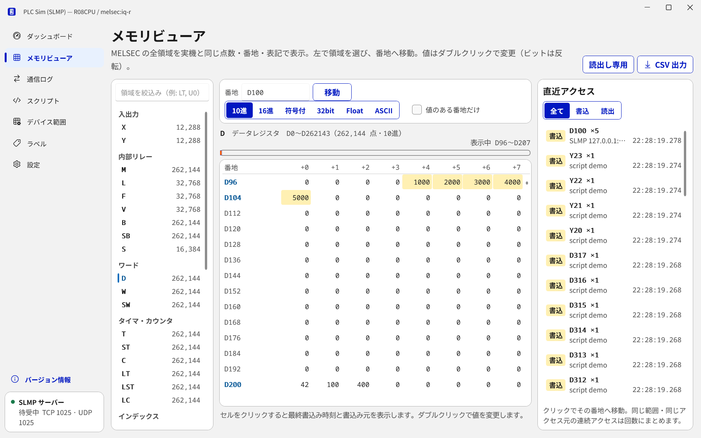
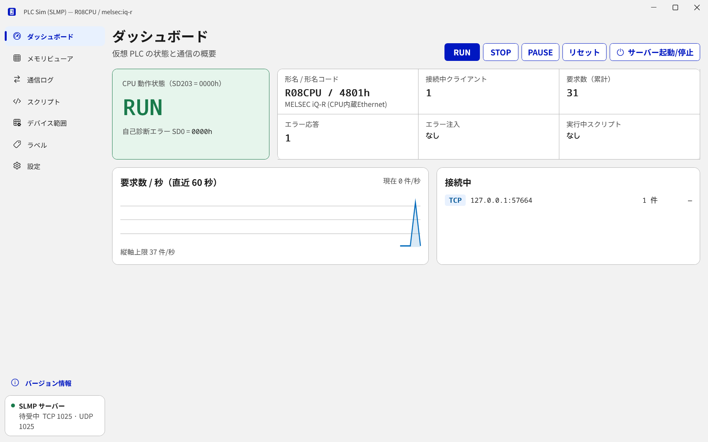
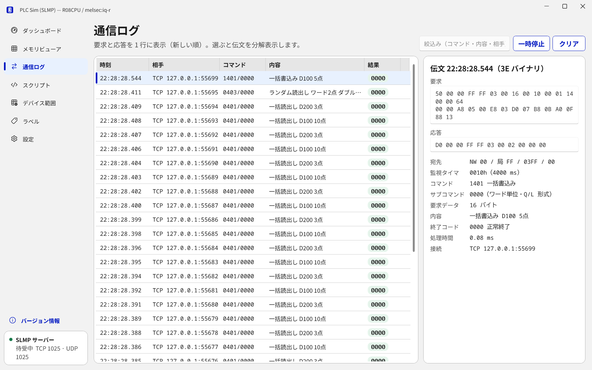
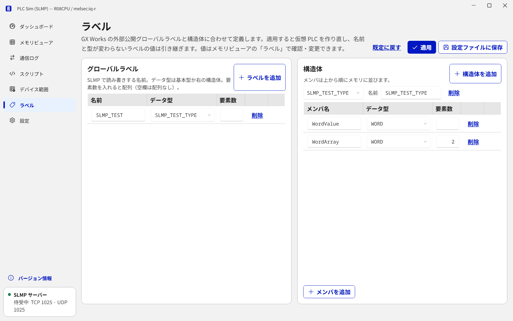

# PLC Sim — SLMP (.NET)

パソコンの中で MELSEC 互換 PLC（iQ-R / Q / L / iQ-F）として SLMP に応答するシミュレータです。
実機がなくても、SLMP で通信するアプリ（上位 PC のプログラム、表示器のテスト、通信ライブラリなど）の開発・試験ができます。

- **実機に近い応答:** iQ-R 実機で計測したデバイス点数・終了コード・メモリの共有（R と ZR、DX と X など）を再現します。
- **中身が見える:** GUI で全デバイスの値、読み書きされた番地、送受信した伝文をその場で確認できます。
- **値を動かせる:** GUI での直接編集のほか、Python スクリプトや HTTP API で値を変えたり、書込みに反応させたりできます。
- **異常も試せる:** 任意の終了コード・応答遅延・無応答を返すエラー注入ができます。



実装済みの機能の一覧は [docs/FEATURES.md](docs/FEATURES.md) にあります。

> 注: MELSEC は三菱電機株式会社の商標です。本ソフトウェアは三菱電機および CC-Link 協会とは関係のない非公式の試験用ツールです。

## 動作環境

- Windows 10 / 11（64 ビット）
- .NET のインストールは不要です（配布版に同梱）。
- Python スクリプト機能を使う場合だけ Python 3.10 以上が必要です。

## はじめかた

1. [Releases](https://github.com/fa-yoshinobu/plc-sim-slmp-dotnet/releases) から `PlcSim.Slmp-vX.Y.Z-win-x64.zip` をダウンロードし、好きな場所に展開します。
2. `PlcSim.Slmp.Gui.exe` を起動します。起動するとすぐ SLMP サーバーが動き始めます。
3. 通信したいアプリから次の宛先に接続します。

   | 項目 | 既定値 |
   |---|---|
   | IP アドレス | `127.0.0.1`（同じパソコン） |
   | ポート | `1025`（TCP・UDP の両方） |
   | 機種 | iQ-R（R08CPU） |
   | フレーム・コード | 3E / 4E、バイナリ / ASCII（受信した伝文に合わせて応答） |
   | 宛先 | 自局（ネットワーク 0 / 局番 FF / 要求先ユニット 03FF） |

4. 「メモリビューア」で、アプリが読み書きした値と番地を確認します。

展開したフォルダの中身:

| ファイル・フォルダ | 内容 |
|---|---|
| `PlcSim.Slmp.Gui.exe` | GUI 版（通常はこちら） |
| `PlcSim.Slmp.Host.exe` | コンソール版（画面なしで動かすとき） |
| `config/default.json` | 設定ファイル（GUI の「設定」画面から保存した内容もここに入ります） |
| `python/plc_sim.py` | Python スクリプト用ライブラリ |
| `scripts/` | Python スクリプトのサンプル |

### 交信データコード

既定の「自動」では、バイナリと ASCII のどちらの要求にも応答します。実機はポートごとにどちらか一方だけを設定し、違うコードの要求にはエラーも返さず応答しません。実機と同じ動きにするときは、「設定」で交信データコードを「バイナリ」か「ASCII」にします（`config/default.json` の `server.dataCode`）。応答しなかった要求は通信ログに「無応答」と表示されます。

### ほかのパソコンから接続する

既定では同じパソコンからの接続だけを受け付けます。ほかのパソコンや PLC 用表示器から接続するときは、GUI の「設定」で待受アドレスを `0.0.0.0` にして「適用」→「設定ファイルに保存」を押すか、`config/default.json` の `server.bindAddress` を `"0.0.0.0"` にしてください。Windows ファイアウォールの許可を求められたら許可します。

## 画面

| 画面 | できること |
|---|---|
| ダッシュボード | CPU の状態（RUN / STOP / PAUSE）、接続中のクライアント、要求数の推移を見る。RUN・STOP・リセット、サーバーの起動・停止 |
| メモリビューア | 全デバイス（X/Y/M/D/W/R/ZR/T/C/LT/SM/SD など）、バッファメモリ（Un\G・U3En\HG）、リンクダイレクト（Jn\）、ラベルの値を見る・変える。番地ジャンプ、10 進 / 16 進 / 符号付 / 32bit / Float / 文字列の切替、値のある番地だけ表示、CSV 出力。右側の「直近アクセス」で、どのアプリがどの番地を読み書きしたかを確認し、クリックでその番地へ移動 |
| 通信ログ | 送受信した伝文の一覧と、項目ごとの分解表示（コマンド・サブコマンド・終了コードなど） |
| スクリプト | Python スクリプトの作成・編集・実行・停止と、出力の表示 |
| デバイス範囲 | デバイス点数を実機のパラメータに合わせる。装着ユニット（Un\G）とネットワーク番号（Jn\）の登録 |
| ラベル | SLMP で読み書きするラベルの追加・編集・削除。グローバルラベル（名前・データ型・配列の要素数）と構造体（メンバの並び）を GX Works の定義に合わせる。既定は `SLMP_TEST`（WordValue: WORD、WordArray: WORD[2]） |
| 設定 | 機種、形名、待受アドレス・ポート、交信データコード（自動 / バイナリ / ASCII）、RUN 中書込み、リモートパスワード、HTTP API、Python の場所、表示テーマ（システム / ライト / ダーク）、エラー注入 |
| バージョン情報 | 左下の「バージョン情報」から。バージョン、使用ライブラリ、ライセンス |

| ダッシュボード | 通信ログ |
|---|---|
|  |  |



値の変更は、メモリビューアでセルをダブルクリックします。ラベルの値はメモリビューアの「ラベル」で確認・変更できます。

「デバイス範囲」「ラベル」「設定」の変更は「適用」で反映され、「設定ファイルに保存」で次回起動時にも使われます。

## 機種の選び方

GUI の「設定」の機種で選びます。応答の形式や対応範囲が、選んだ機種の実機に合わせて変わります。

| 機種（プロファイル） | 想定する接続先 | 実機との違いを再現している主な点 |
|---|---|---|
| `melsec:iq-r`（既定） | iQ-R CPU 内蔵 Ethernet | 実機の最大点数（M/D/T/C/LT 262144 点、ZR 4915200 点など）、S は読出し専用、ラベル `SLMP_TEST` |
| `melsec:iq-r:rj71en71` | iQ-R + RJ71EN71 | 同上 |
| `melsec:qnudv`, `melsec:qnu` | Q CPU 内蔵 Ethernet | 形名読出し・ブロック読書き・Un\G・Jn\ は非対応（エラー C059） |
| `melsec:qcpu:qj71e71-100` ほか | Q + QJ71E71-100 | 形名・ブロック読書きに対応 |
| `melsec:lcpu` | L CPU 内蔵 Ethernet | QnU 内蔵と同じ（形名読出し・ブロック読書き・Un\G・Jn\ は非対応） |
| `melsec:lcpu:lj71e71-100` | L + LJ71E71-100 | QnU + QJ71E71-100 と同じ |
| `melsec:iq-f` | iQ-F（FX5U など） | X/Y は 8 進、モニタ・Jn\ は非対応 |

補足:
- デバイス点数は「デバイス範囲」画面で実機のパラメータに合わせられます。SD260 以降の点数レジスタにも反映されます。
- バッファメモリ（Un\G）とリンクダイレクト（Jn\）は、登録したユニット・ネットワーク番号だけ応答します（既定は U0 と J1、各最大 4 個）。U3E0〜U3E3 は登録不要です。
- L の形名コード（形名読出しで返すコード）は未確認のため 0 を返します。実機に合わせるときは `config/default.json` の `plc.modelCode` を設定してください。
- リモートリセットは実機と同じく STOP 中だけ受け付け、応答を返さずに全接続を切って再起動します（RUN 中・PAUSE 中は 4013）。再起動後は「起動時の状態」になります。再起動中に応答しない時間は `config/default.json` の `plc.resetRestartMs` で指定できます（実機 iQ-R 系は約 22 秒、既定 0）。
- 実機で確認できていない終了コードは `src/PlcSim.Slmp.Core/Protocol/EndCodes.cs` に「未検証」と記載しています。

## Python スクリプトで値を動かす

GUI の「スクリプト」画面で新規作成して「実行」を押すと動きます。サンプルの `scripts/counter.py` は、D100 のカウントアップ、Y0 の点滅、M0 が ON になったときの応答をします。

```python
from plc_sim import Plc

plc = Plc()

plc.set("D100", 1234)            # ワード
plc.set("M0", True)              # ビット
plc.set_float("D300", 1.5)       # 32 ビット浮動小数（D300-D301）
print(plc.get("D100"), plc.get_bit("M0"), plc.state)

@plc.every(0.1)                  # 0.1 秒ごと
def tick():
    plc.inc("D100")

@plc.on_write("M0")              # アプリが M0 に書き込んだとき
def on_m0(event):
    if plc.get_bit("M0"):
        plc.set("D200", 1234)

@plc.on_state("Stop")            # STOP になったとき
def stopped():
    plc.set("Y0", False)

plc.run_forever()
```

- 主な関数: `get` / `get_bit` / `get_dword` / `get_float` / `get_string`、`set` / `set_dword` / `set_float` / `inc` / `toggle`、`get_label_word` / `set_label_word`、`run` / `stop` / `reset`、`inject_error`。
- 起動と同時に実行したいスクリプトは、`config/default.json` の `scripts` に書きます（例: `[ "../scripts/counter.py" ]`）。
- GUI の外で実行するときは、シミュレータを起動したまま `python scripts/counter.py` を実行します。
- Python が見つからない場合は、「設定」で Python の場所を指定します。

## HTTP API

PowerShell やテストツールから値を操作できます（同じパソコンからのみ、`http://127.0.0.1:5080`）。

```powershell
Invoke-RestMethod -Method Put http://127.0.0.1:5080/api/devices/D100 -Body '{"values":[42]}' -ContentType application/json
Invoke-RestMethod "http://127.0.0.1:5080/api/devices/D100?count=4&type=hex"
Invoke-RestMethod -Method Post http://127.0.0.1:5080/api/plc/stop
```

| メソッドとパス | 内容 |
|---|---|
| `GET /api/status` | 状態 |
| `GET` `PUT /api/devices/{番地}` | デバイスの読み書き（`type`: bit / u16 / s16 / u32 / s32 / f32 / hex / str。`U0\G0` は `U0%5CG0` と書く） |
| `POST /api/devices/{番地}/inc` `toggle` | 加算・反転 |
| `GET` `PUT /api/labels/{名前}` | ラベルの読み書き |
| `POST /api/plc/run` `stop` `pause` `reset` `error` | CPU 状態の変更 |
| `GET` `POST` `DELETE /api/errors` | エラー注入 |
| `GET /api/log` | 通信ログ |
| `GET` `POST /api/snapshot` | メモリ全体の保存・復元 |
| `GET /api/scripts` | スクリプト一覧 |
| `GET /api/events` | 書込み・状態変化の通知（Server-Sent Events） |

`X-Source` ヘッダを付けると、その名前がアクセス元として直近アクセスに表示されます。

## コンソール版

画面を出さずに動かすときや、自動テストに組み込むときに使います。

```bat
PlcSim.Slmp.Host.exe
PlcSim.Slmp.Host.exe --profile melsec:qnudv --port 5000 --api-port 5081
PlcSim.Slmp.Host.exe --snapshot var\memory.json
```

| 引数 | 内容 |
|---|---|
| `--config <ファイル>` | 設定ファイル（既定は exe から上のフォルダにある `config/default.json`） |
| `--profile <機種>` | 機種プロファイル |
| `--port <番号>` | SLMP の待受ポート（TCP・UDP） |
| `--api-port <番号>` | HTTP API のポート |
| `--snapshot <ファイル>` | 起動時にメモリを復元し、終了時に保存 |
| `--verbose` | 伝文を表示 |

起動後は次のコマンドを入力できます: `status` / `dump D100 32 hex` / `dump M0 64` / `set D100 0x1234` / `set M0 1 BIT` / `run` `stop` `pause` / `labels` / `log 20` / `access 20` / `scripts` / `script add scripts\counter.py` / `error 0401 C051 1`（コマンド 0401 に C051 を 1 回返す） / `save` `load` / `quit`。

GUI 版にも起動引数があります: `--config`、`--theme light|dark`、`--page dash|mem|log|script|range|settings`、`--address D100`（メモリビューアで開く番地）。

## 開発者向け

ソースからのビルド、テスト、配布版の作成、リリース手順は [docs/DEVELOPMENT.md](docs/DEVELOPMENT.md) を参照してください。

## ライセンス

[MIT License](LICENSE)
